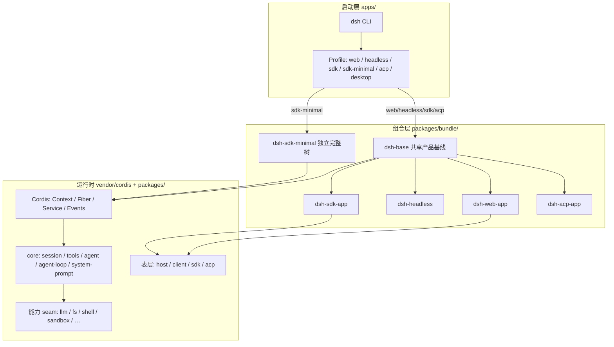
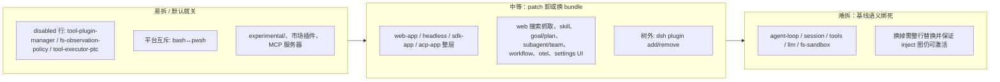

# DeepSeek Harness 架构分析

> 分析对象：`deepseek_dev/deepseek-harness`  
> 依据：`docs/architecture.zh.md`、`packages/bundle/*`、`apps/cli/composition.md`、`AGENTS.md`、`packages/README.zh.md`  
> 日期：2026-11-12

## 结论

架构文档与「一切皆插件」一致。没有特权内核；运行中的 `dsh` 就是 Cordis 插件树。真正要区分的是：

1. **运行时最低骨架**（`sdk-minimal`）
2. **产品基线**（`dsh-base`）
3. **表层 / 可选层**（mode bundle、experimental、树外插件）

---

## 总架构（与官方文档一致）



### 组装顺序

从空条目列表开始，按序叠加：

1. Profile 中有序的 **bundles**
2. Profile 的 `cordis.patch.yml`
3. Home patch
4. `--patch` overlay

每条 patch 按 `id` **整行替换**或插入；`disabled` / 平台表达式可关掉行。`preset` patch 在目标声明的 `config.plugins` 内应用相同优先级。

权威来源：

- `deepseek-harness/docs/architecture.zh.md`
- 生成组合图：`deepseek-harness/apps/cli/composition.md`
- Bundle 实体：`deepseek-harness/packages/bundle/*/cordis.patch.yml`

---

## 「一切皆插件」到底指什么

| 说法 | 实际含义 |
|---|---|
| 无特权内核 | agent-loop、LLM 适配器、工具、会话日志、Web UI 都是插件，可被 patch 替换 |
| 扩展方式 | 旁挂插件 + 声明式 `inject`，不是改内核补丁 |
| 注册可逆 | `ctx.effect()` / `ctx.on()`；卸载即撤销 |
| 替换能力靠 seam | Service Definition / Provider / Consumer 三角；换 provider 即可换整条能力链 |

**框架底座（vendor，仍是插件）：**

- `cordis`（Context / Fiber / Service / Events）
- `cordis-plugin-loader`
- `cordis-plugin-include`
- `cordis-plugin-group`
- `cordis-plugin-timer`
- `cordis-plugin-hmr`
- `cordis-plugin-logger-console`

---

## 哪些是「基本使用」？分三层看

### 1. 运行时最低骨架（`sdk-minimal` 证明）

刻意**不**叠 `dsh-base`。能跑一轮 coding agent 的最小集合大致是：

| 类别 | 插件 / 能力 |
|---|---|
| 循环主干 | `llm`、`session`、`system-prompt`、`tools`、`tool-executor-native`、`agent`、`agent-loop` |
| 执行面 | `subprocess`、`sandbox`(+policy)、本地 `fs`、按平台的持久 shell/PTY |
| 会话 | JSONL 持久化、checkpoint、working-directory、`read_image`、compaction/image-offload |
| 接入 | SDK stdio + JSON-RPC（该 profile 场景） |
| 可选挂载点 | `mcp-resources`（无服务器时不贡献工具） |

**明确排除：** settings、托管凭据、遥测、Web 工具、skill、jobs/subagent、完整文本文件工具栈、workspace 指令等。

→ 这是「能用」的下限，不是产品完整体验。

### 2. 产品基线（`dsh-base`）——日常基本使用

`web` / `headless` / `sdk` / `acp` 的共享第一层。开箱即有：

- DeepSeek 模型接入 + 会话持久化 / 投影 / 检索
- 沙箱 FS + shell + 审批 / 权限
- 完整工具面：fs、web、skill、todo/goal、subagent/team、workflow/ptc…
- settings / credentials / otel / plugin-manager（有 profile 上下文时）

**主干硬依赖（拆了就不成 agent）：**

- `session`
- `tools`
- `agent`
- `agent-loop`
- `system-prompt`
- `llm` + 至少一个适配器
- `fs-sandbox`（base 约定唯一写路径）

#### `dsh-base` 中的主要插件行（摘自组合图）

| 分组 | 代表 id |
|---|---|
| 启动 / 管理 | `plugin-manager`、`timer`、`hmr`、`config-editor`、`settings` |
| 模型 | `llm`、`llm-retry`、`llm-pi-ai`、`llm-deepseek`、`llm-deepseek-account`、`deepseek-llm-api-extensions` |
| 会话 | `session`、`session-persistence-jsonl`、`session-projection`、`session-query-sqlite`、`session-title*`、`session-checkpoint-policy`、`session-log-deepseek` |
| Agent 循环 | `agent`、`agent-loop`、`system-prompt`、`agent-default-model`、`agent-instructions` |
| 工具主干 | `tools`、`tool-executor-native`、`tool-executor-ptc`（默认 disabled） |
| 执行 / 沙箱 | `subprocess`、`sandbox`、`sandbox-policy`、`bash-sandbox`/`pwsh-sandbox`、`fs-sandbox`、`approval`、`permission` |
| Shell 工具 | `tool-bash`/`tool-pwsh`、`shell-env`、`tool-jobs`、`jobs` |
| 文件工具 | `tool-fs`、`tool-fs-search`、`working-directory`、`tool-working-directory` |
| Skill / 命令 | `skill`、`skill-filesystem`、`tool-skill`、`commands`、`command-feedback` |
| Goal / Plan | `goal`、`goal-round-driver`、`command-goal`、`tool-goal`、`plan-mode`、`tool-todo` |
| Subagent / Team | `subagent`、`subagent-spawn-in-process`、`subagent-fork-in-process`、`tool-subagent*`、`agent-team`、`tool-agent-team` |
| Workflow / PTC | `ptc-runtime`、`workflow-ptc`、`tool-workflow` |
| Web | `web`、`web-search-deepseek`、`web-deepseek-api`、`web-fetch-http`、`tool-web` |
| Compaction | `token-meter`、`compaction-basic`、`command-compact`、`tool-result-pruner`、`image-offload` |
| 存储 / 遥测 | `storage*`、`attachment-local`、`spill*`、`otel`、`session-telemetry-otel` |
| 凭据 / 账户 | `credentials`、`authorization`、`deepseek-account` |
| MCP | `mcp-resources` |

### 3. 表层 bundle（按 profile 叠上）

| Profile | Bundles | 作用 |
|---|---|---|
| `web` | `dsh-base` + `dsh-web-app` | 浏览器 GUI / Host + Client |
| `headless` | `dsh-base` + `dsh-headless` | 一次性 CLI 任务 |
| `sdk` | `dsh-base` + `dsh-sdk-app` | 完整 JSON-RPC SDK |
| `acp` | `dsh-base` + `dsh-acp-app` | 仅自动化 ACP |
| `sdk-minimal` | 仅 `dsh-sdk-minimal` | 极简独立树 |
| `desktop` | 保留 `$DSH_HOME/profiles/desktop` | Electron 壳 + 精确匹配的 dsh 运行时 |

`web-app` 额外挂载大量 Host/Client 行（示例）：`webserver`、`web-runtime`、`session-controller`、`ui-*`、`workspace`、`mcp-manager`、`schedule`、`directory-picker` 等。

---

## 哪些可拆卸？

按「拆卸成本」从易到难：



### 可拆卸（产品仍可跑，能力变少）

- **整层 mode bundle**（不要 GUI 就不用 `web-app`）
- **base 内能力插件**：`tool-web`、`skill*`、`goal*`、`subagent*`、`workflow*`、`otel*`、`plan-mode`、`tool-todo` 等 → 用 profile / `--patch` 删或 `disabled: true`
- **base 里默认已关**：`tool-plugin-manager`、`fs-observation-policy`、`tool-executor-ptc`
- **实验包** `packages/experimental/*`、Codex/Claude 等可选 subagent 提供方
- **HMR**：base 默认开；headless/sdk/acp 关；minimal 根本没有
- **树外插件**：`dsh plugin --profile <name> add|remove <package>`

### 不宜当「可拆」理解的

- Cordis loader/include 与启动器本身
- `agent-loop` / `session` / `tools` / `llm` 三角（拆了只剩空壳）
- base 下同时挂非沙箱 `fs-local` 会与 `fs-sandbox` 冲突并加载失败

---

## 仓库物理分层（对应架构图）

| 目录 | 角色 |
|---|---|
| `vendor/` | Cordis 插件框架（rescoped 为 `@deepseek-ai/*`） |
| `packages/core` 等 | 能力 / 服务插件（真正业务） |
| `packages/bundle/` | 声明「装哪些插件」的 patch 层 |
| `apps/` | 具名 profile 启动入口（`cli`、`web`、`desktop`…） |
| `python/` | Python SDK / 运行时 wheel |
| `native/` | 原生 addon（如 Landlock 等） |
| `docs/` | 架构、子系统、cookbook、生成目录 |
| `website/` | VitePress 文档站 |

### `packages/` 能力分组（摘要）

| 组 | 职责 |
|---|---|
| `core/` | 会话、提示词、工具、agent、agent-loop |
| `llm/` | 模型抽象 + 适配器 |
| `fs/` / `shell/` / `subprocess/` / `sandbox/` / `terminal/` | 执行世界 |
| `web/` / `skill/` / `mcp/` / `lsp/` | 面向模型的外部能力 |
| `subagent/` / `team/` / `jobs/` / `workflow/` | 委派与后台任务 |
| `session/` / `session-query/` / `storage/` / `attachment/` | 持久化平面 |
| `interaction/` / `settings/` / `credentials/` | 人机与配置 |
| `host/` / `client/` / `sdk/` / `acp/` / `boot/` | 应用表层与启动粘合 |
| `bundle/` | profile 组合包 |
| `experimental/` | 评估中、无产品支持承诺的能力 |
| `util/` | 零依赖工具 |

---

## 事件与轮次（核心运行时语义）

三个事件域：

1. **会话事件** — 追加到日志，经 `session/event` 广播；需持久化时使用
2. **Agent 事件**（`agent/*`）— inbox、步骤、状态、请求、续跑；拦截进行中工作时使用
3. **能力事件** — `fs/*`、`tools/*`、`telemetry/*` 等 seam 策略

**模型可见即已记录：** 每个模型请求都必须能从会话日志重建。

轮次流程概要：

```text
turn/start
  claim input → agent/pre-step → assemble prompt/tools
  step/start → agent/request → prepareCall → stream llm
  tool/call* → tools/pre-execute → tools/execute → tools/post-execute → tool/result*
  step/end → （可能下一 step）
  agent/turn-stopping
turn/end
```

---

## 对照本机实际挂载树

```sh
dsh --profile web --dump-config
# 或
dsh --profile sdk-minimal --dump-config
```

打印出的任何条目，都可以由你自己的 patch 替换。

---

## 一句话确认

官方架构图（Profile → Bundle 叠层 → Cordis 插件树 → seam/事件扩展）与源码一致。

- **基本使用** = `dsh-base`（或更瘦的 `sdk-minimal`）
- **可拆卸** = mode 表层 + base 内能力插件 + 实验/树外插件
- **真正不可拆** = Cordis 上下文 + `agent` / `session` / `tools` / `llm` 这条循环骨架
