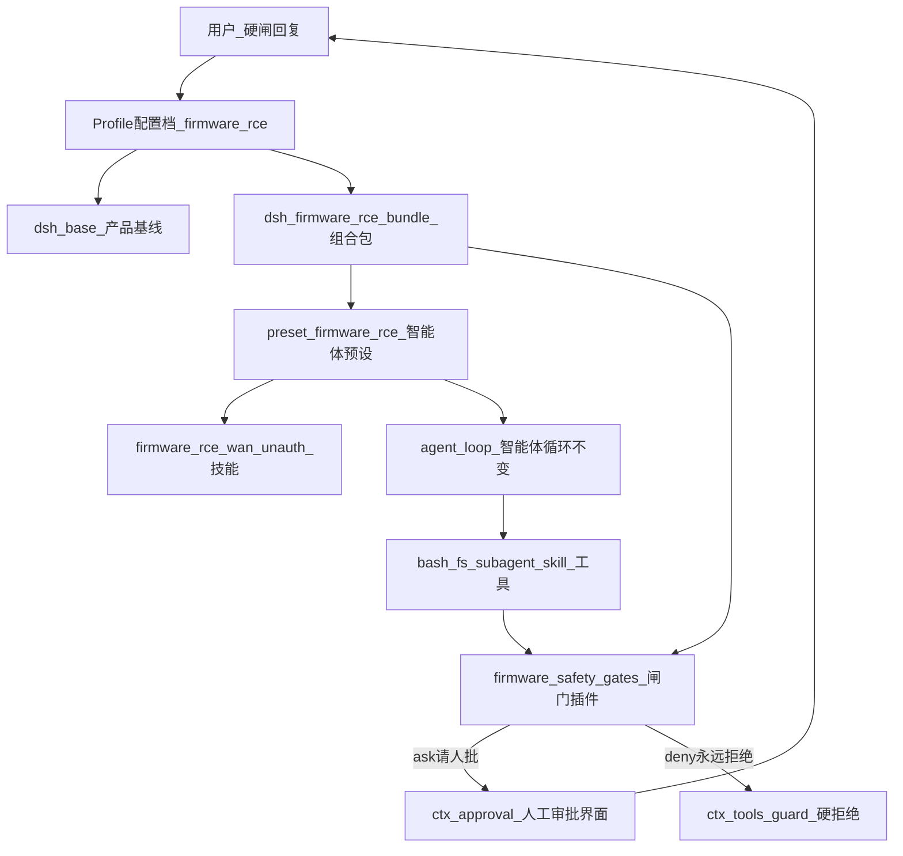

# 固件 RCE（远程代码执行）挖掘 Agent（智能体）（DSH / DeepSeek Harness 改造思路）

> 落盘日期：2026-11-12  
> 关联：[`deepseek-harness-architecture.md`](./deepseek-harness-architecture.md) · [`dsh-community-custom-agent-patterns.md`](./dsh-community-custom-agent-patterns.md)  
> 来源 skill：`.cursor/skills/firmware-rce-wan-unauth`

> **已锁定（经社区调研强化）**：交付用**独立树外 bundle（组合包）/ preset（智能体预设）**叠在上游 DSH（几乎无人靠 fork（分叉整仓）做业务）；人工闸覆盖**安全硬闸 + MEA（多角色编排）阶段硬闸**，且授权通道不得被模型伪造。

## 术语速查（读正文前可先扫一眼）

| 英文 | 中文含义 |
|---|---|
| DSH / DeepSeek Harness | DeepSeek 开源智能体框架 |
| Cordis | DSH 底层的「一切皆插件」运行时框架 |
| plugin | 插件：向共享上下文注册服务/事件/工具的模块 |
| bundle | 组合包：带 `dsh.bundle` 的 npm 包，用 patch（补丁配置）往配置树插插件行 |
| profile | 配置档/启动档案：`$DSH_HOME/profiles/<名>`，列出叠哪些 bundle |
| preset | 智能体预设：某类会话的人设、工具清单、技能目录组合 |
| Host | 宿主进程侧（相对浏览器 Client） |
| Client | Web/GUI 浏览器半侧 |
| agent-loop | 智能体主循环：组提示词 → 调模型 → 跑工具 → 写会话 |
| runtime | 运行时：进程里真正拦截/放行工具的逻辑（相对纯文案约束） |
| skill | 技能说明书（如 `SKILL.md`），模型按需加载 |
| persona | 人设/系统身份前缀 |
| seam | 能力接缝：可替换的 Service Definition（服务定义）/ Provider（提供方）/ Consumer（消费方） |
| inject | 声明依赖的服务，就绪后才启动插件 |
| patch / cordis.patch.yml | 按 id 整行替换或插入的配置补丁 |
| tools/pre-execute | 工具执行前的瀑布式钩子，可返回 allow/ask/deny |
| approval | 人工审批（弹卡片等人点允许/拒绝） |
| guard | 硬拒绝守卫：审批之后仍可一票否决，不能等人 |
| sandbox | 沙箱：主要限制文件读写范围 |
| MEA | Multi-role Evidence Audit：Planner/Executor/Verifier 三角色 |
| SSOT | Single Source of Truth（单一事实源） |
| kanban | 看板目录：合同/事实/审计的落盘 SSOT |
| out-of-tree | 树外：独立仓库，不改上游 monorepo |
| fork | 分叉修改上游仓库 |
| MVP | Minimum Viable Product（最小可行版本） |
| PoC | Proof of Concept（概念验证利用脚本） |
| marker | 无害标记命令（相对反弹壳等危险载荷） |
| subagent | 子智能体（委派出去的子任务会话） |

## 社区调研：别人怎么做业务定制

详见 [`dsh-community-custom-agent-patterns.md`](./dsh-community-custom-agent-patterns.md)。摘要：

- 生态入口：GitHub `topic:dsh-plugin`（插件话题标签）；目录站 awesome-dsh-plugin / dsh-plugin-radar / dsh-plugin-index
- 官方约定：bundle = `dsh.bundle.patch`；安装 = `dsh plugin --profile <name> add <pkg>`；**不是** fork harness
- 对标项目：dsh-plugin-kit、dsh-reverse-security、dsh-redteam-model、dsh-voredteam、legacy-firmware-reversing、portable-dsh-multi-agent-plugin、dsh_workflow、dungeon-party / swarm、dsh-plugin-subagents、dsh-security-audit

### 社区共识（与官方架构一致）

1. **几乎不做业务 fork（分叉整仓）**：业务 = 独立仓库 + `dsh-plugin` topic + `dsh plugin add`。
2. **领域 Agent ≈ preset（预设）+ skills（技能）**，重能力才写 Host（宿主）插件。
3. **人工限制分层**：prompt/skill 只教；**真闸** = 工具拦截 / approval / 斜杠命令 / 阶段状态；授权不可被模型伪造。
4. **Preset 与 Bundle 不要双挂同一插件**（否则 resume 报 already registered）。
5. **SSOT 文件**（kanban / PROJECT-STATE / blackboard）是长程安全任务标配。

## 核心判断

不要 fork（分叉修改）`deepseek-harness/packages/core/agent-loop`（智能体循环）。DSH 的领域 Agent = **同一条 loop（循环）** + **不同 preset（预设）组合** + **可逆插件钩子**。所谓「runtime（运行时）修改」应落在：

- `tools/pre-execute`（工具执行前钩子）→ `{ kind: 'ask' }`（请人批准）→ `ctx.approval.request`（发起审批请求，等人）
- `ctx.tools.guard()`（硬拒绝守卫：无论人点什么都禁）
- **斜杠命令授权面**（`/fw-authorize` 类；对齐 `/gov-authorize`——模型不可伪授权）
- permission（权限）/ sandbox（沙箱）预设（文件面）
- persona（人设）+ skill（技能）+ 可选 MEA（多角色编排）编排工具

Skill（技能文）只能约束模型；**真正限制操作的是审批/guard（守卫）/命令管道**（见 `deepseek-harness/packages/core/tools/src/pipeline.ts`）。



## 分层放什么

| 层 | 放什么 | 对应 skill（技能）概念 |
|---|---|---|
| **Profile（配置档）** | 进程服务：沙箱默认 `workspace-write`（工作区可写）+`ask`（需审批）、产物根目录、禁 `danger-full-access`（危险全开）预设或将其审批钉死为 `ask` | 产物仅 `tmp/<fw-hash>/`；默认 marker（无害标记） |
| **Preset（智能体预设）** | 人设、工具白名单、`customSkillDirs`（自定义技能目录）、可选 Planner/Executor/Verifier（规划/执行/核验）子 preset | MEA 三角色；禁倾倒整份 SKILL |
| **新插件包** | 命令/参数分类器 + pre-execute ask（执行前询问）+ guard（硬拒绝）；阶段硬闸状态机；kanban（看板）工具（若要一等公民） | 安全闸；阶段 0–6 硬闸；SSOT（单一事实源） |
| **Skill 目录** | 现有 `.cursor/skills/firmware-rce-wan-unauth` 迁到包内 `skills/` 或 `customSkillDirs` | 阶段机、三轨、references（参考文档） |

## 推荐目录落点（相对本仓库）

在 `deepseek_dev/` 旁建业务层，**不**把业务 patch（配置补丁）直接写进上游 monorepo（单体仓库）的 `packages/bundle/base`：

```
deepseek_dev/
  firmware-rce-agent/
    packages/
      firmware-rce-gates/     # pre-execute（执行前）+ guard（硬拒绝）+ 阶段闸
      firmware-rce-tools/     # 可选：kanban/contract/fingerprint 包装工具
      firmware-rce-bundle/    # cordis.patch.yml：insert preset + 挂插件
    skills/                   # 从 .cursor/skills 迁入或 symlink（符号链接）
    profile-template/         # package.json dsh.profile.bundles
    README.md                 # 启动：dsh --profile firmware-rce
  architecture-analysis/      # 本目录：架构与计划文档（已落盘）
```

上游对照模板：

- Preset：`deepseek-harness/packages/bundle/web-app/presets/standard.patch.yml`
- 最小 preset：`deepseek-harness/packages/bundle/web-app/presets/minimal.patch.yml`
- 审批：`deepseek-harness/packages/interaction/user-approval`
- 权限表：`deepseek-harness/packages/interaction/permission-presets`

## 人工限制：两套闸，不要混用

### A. 安全闸（skill「反弹壳/真机/改密须用户授权」）

| 级别 | 机制 | 动作示例 |
|---|---|---|
| **硬拒绝** | `ctx.tools.guard()`（硬拒绝守卫） | 无 `--target` 的 PoC；默认载荷含反弹特征且未授权；改密命令模式 |
| **等人一次** | `tools/pre-execute` → `ask` | 显式反弹壳、真机/非隔离靶、出网 exploit、`danger-full-access` 升级 |
| **默认放行** | `allow` | 解包、指纹、IDA 静态、marker-only PoC、写 `tmp/<fw-hash>/` |

实现注意：

1. 会话审批策略必须是 `ask`。选了 `danger-full-access` 会把审批钉成 `never`，**卡片不弹出、直接拒绝**——应禁用该预设，或覆写为 `auto`（文件可全开但仍 ask）。
2. **子 Agent 审批被钉成 `never`**（`packages/subagent/subagent/src/child-agent.ts`）。Executor/Verifier 不能自己要人批：危险工具只挂 Planner、或父进程统一拦、或危险步骤回主会话。
3. 不要用 `ask_user_question` 当安全闸——模型不调用就会绕过。

### B. MEA（多角色编排）阶段硬闸（「继续」口令）

Skill 硬闸：加密/解包不自信、WAN 写不出是|否|条件、门禁 D、安全闸。本计划采用 **状态机插件 + 审批**：

1. 插件维护 `phase` / `pending_gate`（可挂 `ctx` 或写入 `kanban/NOW.md`）。
2. 跨阶段动作在 pre-execute 或 `advance_phase` 上返回 `ask`，`displayReason` 带 settled 摘要。
3. 用户点允许 ≡ 口令「继续」；拒绝则停在当前阶段。

软闸（可连跑）不弹审批，只写 `audits/P-*`。

## Preset（预设）与 MEA 三角色

对齐 `.cursor/skills/firmware-rce-wan-unauth/references/roles-mea.md`：

| 角色 | DSH 落点 | 工具面 |
|---|---|---|
| Planner（规划者） | 主会话 preset `firmware-rce-planner` | 读写 kanban、派发 subagent、问人；无 IDA 重活 / 默认可出网 exploit |
| Executor（执行者） | subagent preset 或委派模板 | 合同内 raw 写入、有限 shell；危险工具禁用或回父审批 |
| Verifier（核验者） | 另一 subagent preset | 只读检查；禁止改环境/改 facts |

Persona 用 `@deepseek-ai/dsh-persona`；Skill 经 `customSkillDirs` 挂入；派发硬限写进 persona + 合同工具 schema。

## Skill（技能）迁入方式

1. 把 `.cursor/skills/firmware-rce-wan-unauth` 复制或 symlink 到 bundle 的 `skills/firmware-rce-wan-unauth/`。
2. Preset 中 `customSkillDirs` 指向该目录；保留 frontmatter `name`/`description`。
3. references 按合同「至多 1 个片段」加载；可选 `tool_load_reference` 限制路径前缀。

## 最小可行路径（MVP → 完整）

1. **MVP**：`firmware-rce` profile = `dsh-base` + bundle；一个 preset；挂 skill；`workspace-write`+`ask`；gates 只拦安全类 bash/PoC。
2. **MEA**：kanban 约定 +（可选）`contract_*` 工具；三角色工具面分离。
3. **阶段闸**：`advance_phase` / 跨阶段走 approval；与 skill 硬闸表一一对应。
4. **加固**：禁 danger-full-access；子代理白名单；产物强制 `tmp/<fw-hash>/`。

## 实施待办（尚未编码）

| id | 内容 | 状态 |
|---|---|---|
| research-note | 社区调研独立成文（本目录已落盘） | 本文一并落地 |
| scaffold-bundle | 参照 dsh-plugin-kit 建 `firmware-rce-agent` | 待做 |
| migrate-skill | 迁入 skill；persona + 派发硬限 | 待做 |
| safety-gates | pre-execute ask + guard + 斜杠授权 | 待做 |
| mea-roles | Planner/Executor/Verifier 工具面 | 待做 |
| phase-gates | advance_phase / 阶段硬闸 | 待做 |
| verify-dump | dump-config + 危险调用验收 + README | 待做 |

## 明确不做 / 后置

- 不改 `agent-loop` 源码；新行为走扩展点（`docs/architecture.zh.md`）。
- 不把完整业务逻辑塞进 vendor Cordis。
- 沙箱不识别反弹壳语义——网络/进程闸必须自写分类器。
- 业务层保持 out-of-tree，用 `dsh plugin --profile firmware-rce add <bundle>` 安装。

## 验收标准

- 无授权时：反弹壳 / 真机 / 改密类调用被 ask 或 guard，工具体不执行。
- 授权 once 后：仅该次放行，不永久放开策略。
- 子 Agent 无法静默执行被钉死的危险工具。
- 阶段硬闸未通过时无法进入动态 verified / report 入表路径。
- `dsh --profile firmware-rce --dump-config` 可见 preset + gates 行，且可用 patch 拆卸。
